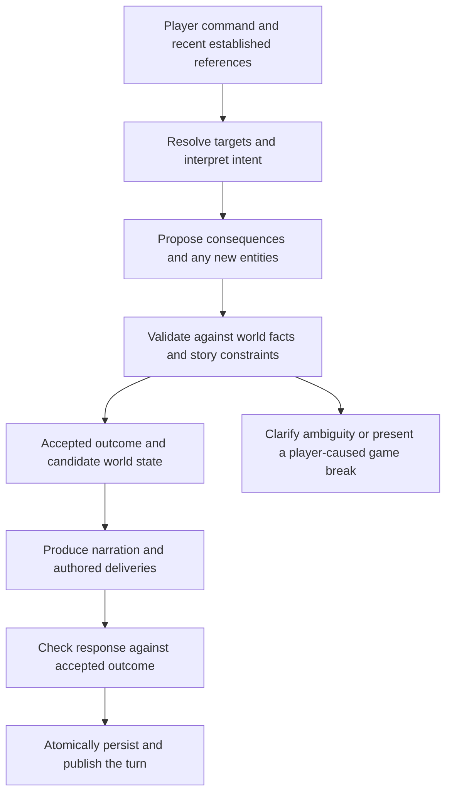

**I would keep the world model, but rethink the turn pipeline.** The evidence does not justify replacing `worldkeeper`, the fact store, or authored progression. It does justify questioning the current arrangement in which the narrator proposes prose and world changes together, and the engine reconciles them afterward.

My earlier material fixes are useful repairs. They are not enough to establish the README’s broader promises.

I reviewed the current checkout, including the new truck-seating work, the reference and capture code, safety validation, and the recent design-review and playthrough records. I did not run new live comparisons. The alternative below is a design recommendation, not a demonstrated winner.

One correction to my previous answer: **the first drawer cue can legitimately appear before turn 10.** Current scheduling uses that threshold for escalation. Its appearance on turn 1 is not itself a defect.

**The strongest evidence supports retaining the foundation.**

The project already has valuable machinery:

- Persistent entity identity, containment, custody, state axes, companions, and groups.
- Deterministic restrictions on hidden objects, fixed objects, and invalid containment.
- Authored knowledge, reveal prerequisites, and fixed reveal delivery.
- Snapshot restoration and game-break decisions.
- Scene-local information boundaries.
- Attempt records that can distinguish several causes of failed progress.

Those are substantial assets. A different database or a more elaborate knowledge graph would not inherently fix “search the gap.”

There is also positive behavioral evidence. The [recent playthrough record](/home/bcorfman/dev/freytag-forge/.plans/playthrough-quality.md:86) reports that all three canonical and all three raw-profile journeys reached the ending. Some required forced progress, but this establishes that the architecture can sustain complete games.

The opposing evidence is equally important: those runs include invented destinations, forced exits, repetitive action failures, and a game-break interruption caused by an invented location. Earlier records include a reference error that created another person instead of applying an action to the intended NPC. Successful completion and correct freeform play are different measurements.

| README promise | Assessment |
|---|---|
| “Type anything” | Input is open-ended. Reliable interpretation is not yet established. |
| “It doesn’t forget” | The engine retains accepted facts. It can retain the wrong interpretation or omit a narrated change. |
| “A plot, not drift” | Authored progression works, but forced handoffs can conceal failures to understand the player. |
| “Earn every reveal” | Prerequisites and delivery ownership are strong. Action recognition remains imperfect, and forced delivery is an explicit exception. |
| “Canon holds” | Current checks protect specified boundaries. They do not prove every narrated claim is consistent. |
| “It grows” | Dynamic creation exists. Distinguishing legitimate invention from mistaken identity is a serious weakness. |
| “Break the story on purpose” | Dependency checks are useful, but the correct entity and consequence must reach them first. |
| “Any story, one engine” | A sound boundary worth preserving. Authoring complexity and story constraints still need clearer contracts. |

**The central problem is that the system has several interpretations of one turn.**

At present, different components interpret:

1. Which objects the command names.
2. Whether an implicit action is needed.
3. Which reveal the command earns.
4. What happens in the prose.
5. Which world changes the reply reports.
6. What newly generated names refer to.

These interpretations can disagree while each is locally plausible.

In the transcript, the narrator interprets the command as a door search, while the reveal path delivers a drawer discovery. The world model cannot reconcile that simply by storing the card’s correct location.

This is a coordination problem around the world model.

Five architectural weaknesses stand out.

**1. Physical state does not provide conversational reference.**

The engine can know where the drawer is without knowing that “the gap” means the gap just described beneath it.

The current [reference-matching payload](/home/bcorfman/dev/freytag-forge/storygame/runtime/item_facts.py:877) supplies the command and in-scope things. It does not supply a structured record of the immediately preceding cue and its referents.

Consequently, the system lacks important evidence for a very ordinary player action.

Adding `gap` as a permanent alias would be the wrong abstraction. It means a feature of the drawer in this exchange, not another universal name for the drawer.

This distinction also matters for “it,” “that,” “the other one,” “back outside,” and corrections.

**2. World validity is weaker than action validity.**

[World movement validation](/home/bcorfman/dev/freytag-forge/packages/worldkeeper/src/worldkeeper/model.py:654) checks meaningful structural constraints: identity, cycles, fixed and hidden entities, and valid parents.

Those checks do not establish:

- Whether the player requested the move.
- Whether the destination is reachable by that action.
- Whether entering a vehicle entails driving away.
- Whether putting something away should instead take it out.
- Whether a search actually examined the place needed to earn a reveal.

A valid containment tree can describe the wrong outcome.

The README’s statement that the world model “never decides what an action does” therefore needs qualification. The model can propose consequences, but the engine needs a contract for which proposed consequences are acceptable.

**3. The prose can survive a rejected world change.**

The [turn implementation](/home/bcorfman/dev/freytag-forge/storygame/runtime/engine.py:116) performs narration validation before the later capture application. [Capture](/home/bcorfman/dev/freytag-forge/storygame/runtime/capture.py:95) can then return issues, including refused moves. A [refused move](/home/bcorfman/dev/freytag-forge/storygame/runtime/item_facts.py:950) is recorded as an issue; that path does not generally rewrite the prose that claimed it happened.

There is a later dependency check, which is valuable. But ordinary disagreement between prose and state is not necessarily a dependency failure.

This is the deepest correctness gap: **rejecting a change in storage does not correct the player’s experience if the response still asserts that change.**

Likewise, a model can omit a change from `item_facts`. Its prose and structured report are two outputs from the same fallible interpretation. Their coexistence does not prove agreement.

**4. Failed reference resolution can become invention.**

In [item-fact application](/home/bcorfman/dev/freytag-forge/storygame/runtime/item_facts.py:1061), unresolved names can become new entities. Some rejected mappings also proceed toward creation.

That makes two fundamentally different situations too close:

- “The story introduces another person.”
- “The resolver failed to recognize the existing person.”

The recorded duplicate-person failure shows the consequence. The dependency checker can correctly protect Brandon while the action is incorrectly applied to a newly created man.

**Unknown identity must remain different from authorized creation.**

**5. Safety validation is narrower than narrative truth.**

The [narration validator](/home/bcorfman/dev/freytag-forge/storygame/runtime/narration_safety.py:72) performs useful checks around permitted names, protected terms, knowledge grounding, and speakers.

It does not generally establish that:

> “Kristin takes the card out”

contradicts:

> “Put the card in my pocket.”

Nor does guarding later-scene names catch every invented clue, new destination, or incorrect causal explanation.

The recent explicit-disclosure work improves the distinction between names and secrets. That should continue. But lexical safety checks should not be treated as a general semantic referee.

**My preferred alternative is to agree on the outcome before writing the final narration.**

Keep one canonical fact store. Introduce a clearer transaction around a turn:

The candidate world is temporary transaction state, not a second source of truth. Its effects are settled before narration. Publication must not introduce additional world changes.

This is a new orchestration proposal relative to the current pipeline. It preserves LLM-proposed actions and story-agnostic runtime behavior.

The important changes would be these.

**Resolve references once, then share that interpretation.**

Create one grounded interpretation used by implicit actions, reveal selection, consequence validation, and narration.

For example, after the drawer cue:

| Part of command | Grounded meaning |
|---|---|
| “search” | Attempt an examination |
| “the gap” | The recently described space beneath the existing drawer |
| Target identity | The declared drawer |
| Relevant spatial relation | Beneath |
| Source of interpretation | The last delivered cue |

The gap need not become a separate physical entity. A reference can identify a feature or relation of an entity.

Retain a small record of recent **accepted, player-visible references**. Derive it from committed turns and authored cues. Store entity links and source spans, not an unconstrained model-written summary of the story.

This deliberately revises the blanket exclusion of conversational context. Avoiding transcript memory prevents some contamination, but excluding the referential information needed to understand the next command is too costly.

When evidence is insufficient, ask a short in-world clarification. A clarification is better than silently moving the wrong object. It should not consume a costly story turn unless that is an explicit game policy.

**Separate attempted actions from accepted consequences.**

The language model still interprets arbitrary language. It proposes consequences using a bounded vocabulary of world operations.

That is compatible with freeform play:

- “Tuck it away” can propose concealment and custody.
- “Slide it across to her” can propose a transfer.
- “Wedge the door with the chair” can propose a supported relation or condition.
- An unfamiliar action can receive an in-world failure or a bounded novel consequence.

A bounded effect vocabulary is not a fixed list of player commands.

However, there is a real limit: a novel action whose important consequences cannot be represented needs a supported extension or a limited response. Arbitrary prose should not silently create capabilities the engine cannot track.

**Give consequential narration a stricter contract.**

The narrator receives the accepted outcome and the relevant before/after facts. It does not independently decide to drive away, expose evidence, or introduce another clue.

For critical changes—custody, movement, discovery, named state changes, transitions—prefer engine-composed or authored clauses derived from the accepted outcome. Let generated prose provide atmosphere and connective detail.

This does not require templating an entire story. It does require acknowledging that unrestricted prose cannot carry hard guarantees merely because it is accompanied by JSON.

An LLM checker can help detect contradictions, but it remains probabilistic. Having the narrator certify its own factual claims is not sufficient.

**Make invention an explicit proposal.**

Preserve dynamic world growth, but require proposed creations to identify:

- What is new, with a temporary identity.
- Its kind and proposed place.
- Why it appears in this turn.
- Whether it has actionable properties.
- Whether it affects access, knowledge, an NPC role, or future dependencies.

Then distinguish three cases:

| Case | Treatment |
|---|---|
| Ordinary descriptive detail | May remain prose if it creates no persistent interaction or consequence. |
| New interactable object | Validate and commit an entity before the player sees it as real. |
| New route, clue, important person, or capability | Require permission from the story’s constraints; ordinary object creation is insufficient. |

For example, invented scattered papers might be acceptable in one story. Papers that imply Michelle left another lead are not equivalent to background clutter.

A new warehouse should not automatically become a valid continuation of a house investigation just because its containment is legal.

Use the same standard for openings, NPC speech, pressure events, and ordinary turns. Otherwise, the opening can introduce unsupported world facts before the normal turn checks begin.

**Keep possession, secrecy, and concealment distinct.**

This transcript also exposes a potential modeling distinction:

- Kristin possesses the card.
- The card’s existence is known to Kristin.
- The officers can or cannot see it.

These are different facts. Reusing the discovery-oriented hidden state for concealment would be wrong: concealing an already discovered object should not make Kristin forget it or offer its discovery again.

Where concealment affects gameplay, represent the relevant visibility or access condition explicitly. Where it is only prose, do not pretend the engine has enforced its consequences.

**Make reveals depend on the accepted action, not another independent reading of the raw command.**

Keep authored prerequisites and authored delivery. Reuse the grounded target and action interpretation when deciding whether the reveal was earned.

For a drawer discovery, the relevant evidence is that the accepted search reaches the specified part of the drawer—not that three word groups happen to occur somewhere in the sentence.

Exact matching can remain a cheap optimization for narrow, tested cases. It should not be the definition of what the player meant.

The existing action-contract work is relevant, but it is not proof that this change will work. The [Step 8 correction](/home/bcorfman/dev/freytag-forge/.plans/design-review-implementation.md:227) explicitly withdrew the claimed live recall gain. Rewording a semantic question is different from sharing one resolved interpretation across the pipeline.

Compound commands should likewise have ordered subactions. “Open the drawer and search beneath it” is not intrinsically an ambiguous competition between two reveals. The engine can still limit deliveries, but it should distinguish that policy from failure to understand the command.

**Unify timed events with the same outcome validation.**

The patrol problem should be expressed through event prerequisites and current world state:

- A return presupposes an earlier visit.
- A search happens at a particular location.
- A concealment claim presupposes access to the card.
- A laptop notice presupposes the laptop is where the sentence says.

The clock can propose pressure. It should not bypass those conditions.

Preserve game-break choice for consequential player decisions. An unwanted consequence invented by the narrator should be repaired or rejected internally, rather than asking the player to approve an action they never requested.

This also requires checking more than item availability. A newly invented route can undermine a scene without destroying any required object.

**I would compare alternatives before committing to that migration.**

| Approach | Strength | Limitation | Recommendation |
|---|---|---|---|
| Current design plus material fixes | Smallest change; supported by successful prior repairs | Leaves independent interpretations, ambiguous references, and prose/state disagreement | Keep as baseline and immediate repair |
| Stronger model, same pipeline | May improve interpretation with little restructuring | Does not establish a missing correctness contract | Include as a serious control |
| Current world model plus outcome-first pipeline | Directly addresses the identified failure paths | New complexity, possible latency and creativity costs; unproven here | Preferred prototype |
| Replace with a conventional action simulator | Stronger guarantees within its modeled actions | Much larger scope; risks abandoning the project’s freeform premise | Not justified now |

TextWorld is an established example of text games backed by explicit game rules and state. It supports the value of the symbolic foundation, but does not establish that a conventional action system meets this project’s open-ended goals. [Microsoft’s TextWorld overview](https://www.microsoft.com/en-us/research/project/textworld/overview/).

Nor should “two model stages” automatically be rejected as more expensive than the current design. The current path can already make calls for implicit actions, reference matching, semantic reveal selection, narration, and subsequent name checks. Measure total requests, tokens, and latency per accepted turn.

Conversely, another call is not automatically an improvement. The project’s older extraction experiments include worse results from a separate post-narration capture call. An outcome-first prototype must demonstrate its advantage.

**The decision should turn on a controlled evaluation, not another polished demonstration.**

I would use three comparable arms:

1. Current architecture with the agreed material fixes.
2. The same architecture with a stronger model.
3. The smallest outcome-first prototype, using the same story material.

Start with this drawer-to-truck sequence and a second, unrelated story package. Preserve all existing machinery that can be reused. Do not rewrite all nine scenes first.

The test set should include:

- Short references immediately after cues.
- The same phrase with two genuinely plausible referents.
- Pocketing versus withdrawing, entering versus driving, and ordered compound actions.
- Player corrections and unrelated restraint clauses.
- A new harmless object and a new object that would bypass the plot.
- An unresolved reference to an existing NPC that must not create a duplicate.
- A refused physical move whose prose must also show refusal.
- Concealment followed by an NPC encounter.
- Save/load between a cue and the follow-up command.
- A reveal attempted before and after its prerequisites.
- Intentional player-caused damage to a future dependency.

Measure separate outcomes: correct reference, correct action, correct state, correct prose, false reveal, unauthorized creation, forced progress, clarification burden, and latency. Do not collapse them into one “capture accuracy” score.

Use 10–15 samples per fixed-prompt arm for diagnosis. Then evaluate held-out commands and varied starting states. A favorable small probe is a reason to continue, not a reliability claim.

I would drop the architectural prototype if its improvement disappears on held-out language, if it increases false reveals or story-breaking inventions, or if it achieves apparent correctness by refusing ordinary play. I would keep the current architecture if the stronger-model or material-only arm meets the same quality bar more simply.

**My present judgment is option B for turn orchestration, with option A for the underlying world model.** The current foundation is worth preserving. The main design change should make reference resolution, accepted consequences, narration, and persistence describe the same event. Wording amendments remain necessary, but they should support that contract rather than carry responsibility for enforcing it.